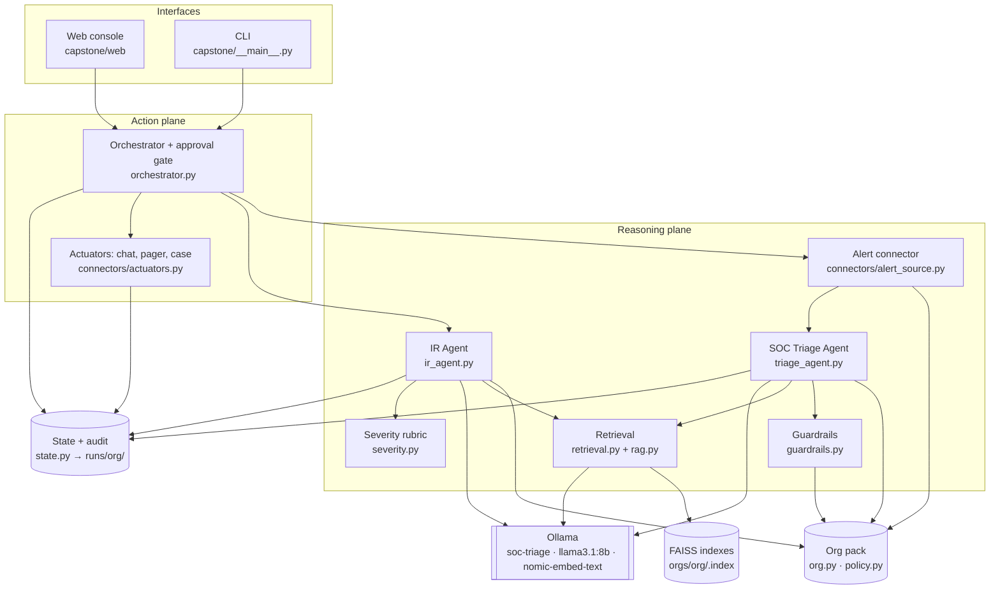
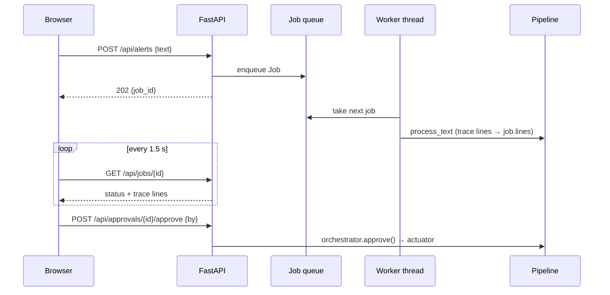

# Architecture

## 1. Two planes

The system is split into a **reasoning plane** and an **action plane**, with an approval gate between them.

| Plane | Contains | Can it change the outside world? |
|---|---|---|
| Reasoning | Connector, SOC Triage Agent, guardrails, IR Agent, severity rubric | No. It only produces decisions, packages and plans. |
| Action | Orchestrator, actuators (chat, pager, case) | Yes, but only automatic internal actions, or gated actions a human approved. |

The agents never import or call an actuator. The orchestrator is the only code that executes actions, and it executes a gated action only through `approve()`.

## 2. Engine and org packs

```
capstone/            the engine: agents, guardrails, severity math, policy engine, mapping, actuators, web, CLI
orgs/<id>/           one org pack per organization: org.json, playbooks/, knowledge/, ir/, sources/, samples/
runs/<id>/           that org's state (audit, alerts, incidents, approvals, actions)
orgs/<id>/.index/    that org's vector indexes (triage, ir)
```

The engine reads policy only through `capstone/org.py` (`org.current()`), so one engine serves any number of organizations, one org pack per running instance. What is fixed in the engine and what each org configures:

| Fixed in the engine (safety and mechanics) | Configured per org |
|---|---|
| Disposition logic; guardrails only add caution | Close threshold, confidence mapping |
| Impact point scale; severity overrides (Tier-0/destructive → SEV1, exfiltration +1, disabled account ≥ SEV2); impact floors | Severity cut-offs, response targets, asset rules, Tier-0 assets/accounts, signal technique lists |
| People-reaching actions are always gated | Escalation rules: who, when, why |
| Injection detection; HTML escaping; approval attribution | Roster file and columns, privileged prefixes |
| Canonical alert schema; rendering for the model | Source field mappings |
| Actuator interface; secrets only from env vars | Which actuator per channel |

## 3. Components



| Module | Responsibility | LLM? |
|---|---|---|
| `org.py` | Load and activate an org pack; roster reading (CSV or Markdown table); sources | no |
| `validate.py` | Check an org pack: profile, assets, roster, playbook format, mappings, policy, actuators | no |
| `policy.py` | Evaluate escalation rules into an action plan; enforce the human-gate invariant | no |
| `connectors/alert_source.py` | Built-in EDR parser; vendor JSON mapping; re-render for the model; stable `alert_id` | no |
| `retrieval.py` | FAISS search for both agents; builds an org's triage and IR indexes | embeddings only |
| `triage_agent.py` | Run the fine-tuned model with RAG; parse output; disposition; dedup; Escalation Package | `soc-triage` |
| `guardrails.py` | Roster, Tier-0 and prompt-injection rules | no |
| `ir_agent.py` | Extract incident facts; impact floors; incident record; SLA; action plan | `llama3.1:8b` |
| `severity.py` | Severity math with org cut-offs and fixed overrides; asset criticality and Tier-0 from org rules | no |
| `orchestrator.py` | Source → alert; pipeline wiring; dispatch auto vs. gated actions; approve / deny | no |
| `connectors/actuators.py` | Mock, Slack webhook, PagerDuty Events v2 and generic webhook actuators, chosen per org | no |
| `state.py` | JSON state files, audit log, approval queue, locking | no |
| `web/server.py` | FastAPI app, background worker, REST API | no |
| `web/static/` | Console UI (HTML/CSS/JS, no build step) | no |
| `eval_disposition.py` | Disposition evaluation with cached answers | `soc-triage` |

## 3. Models and knowledge

| Agent | Model | Why this model | Knowledge base |
|---|---|---|---|
| SOC Triage | `soc-triage` (Llama 3.2 3B, fine-tuned, Q4_K_M) | Trained on this alert format and verdict taxonomy; fast; consistent output format | org's `triage` index (Demo Corp: CSOC playbooks, admin roster, approved tools, known false positives, change calendar) |
| IR | `llama3.1:8b` | Better general reasoning for reading a whole package; supports JSON mode | org's `ir` index (Demo Corp: the 10 IR playbooks + `ir_docs/` severity rubric and escalation contacts) |
| Embeddings | `nomic-embed-text` | Same model the original RAG pipeline uses | both indexes |

The models are shared by every org. What changes per org is what they retrieve and the policy applied to their output.

## 4. Data contracts

### Canonical alert
Produced by the connector; every agent reads these fields, not the vendor format.

```json
{
  "alert_id": "alt-ebeba5747c",
  "source": "edr", "format": "kv",
  "detection": "Remote service creation (PsExec-style)",
  "vendor_severity": "High", "timestamp": "2026-08-17T17:19:01Z",
  "host": "WS-SLS-118", "device_group": "Sales Workstations", "os": "Windows 11 23H2",
  "user": "CORP\\adm-hschmidt",
  "process_image": "C:\\Users\\adm-hschmidt\\Downloads\\PsExec64.exe",
  "command_line": "PsExec64.exe \\\\SRV-APP12 -s cmd /c \"ipconfig /all & ...\"",
  "process_tree": "C:\\Windows\\System32\\cmd.exe <- C:\\Windows\\explorer.exe",
  "signature": "...", "prevalence": "...", "sha256": "...", "network": "...", "context": "...",
  "raw": "EDR ALERT\nDetection: ..."
}
```
`alert_id` is a hash of the alert body, so the same alert always gets the same ID, whatever its line endings or instruction prefix.

### Escalation Package
The SOC → IR contract (`SOCTriageAgent.escalate()`). It is structured, not a ping: it carries everything the IR agent and a human reviewer need.

```json
{
  "escalation_id": "esc-2026-0003",
  "idempotency_key": "WS-SLS-118:remote-service-creation-psexec-style:2026-08-17",
  "created_by": "soc-triage-agent",
  "created_at": "2026-11-14T10:02:11Z",
  "alerts": [ { "...canonical alert without raw..." } ],
  "triage_verdict": "Needs Investigation",
  "attack_techniques": ["T1569.002", "T1036.005"],
  "evidence": ["..."],
  "summary": "...",
  "enrichment": {
    "decoded_payloads": [],
    "asset_criticality": "medium",
    "guardrails": [{"rule": "disabled_account", "effect": "force_escalate", "reason": "..."}]
  },
  "confidence": 0.7,
  "rationale": "Guardrail forced escalation (model said Needs Investigation): ...",
  "sources": ["admin_roster.md", "approved_tools_allowlist.md"]
}
```

### Incident
Written by `IRAgent.handle()`.

```json
{
  "incident_id": "inc-2026-0003", "escalation_id": "esc-2026-0003",
  "severity": "SEV2",
  "severity_detail": {
    "score": 2,
    "breakdown": {"asset_criticality": {"value": "medium", "points": 1},
                  "impact": {"value": "attempted", "points": 1},
                  "scope": {"value": "single_host", "points": 0}},
    "reasons": ["score 2 = criticality 1 + impact 1 + scope 0", "disabled-account override: minimum SEV2"]
  },
  "facts": {"is_incident": true, "impact": "attempted", "scope": "single_host",
            "data_exfiltration": false, "tier0_involved": false, "playbook_id": "PB-LAT-01",
            "incident_summary": "...", "rationale": "..."},
  "code_signals": {"tier0": false, "destructive": false, "exfiltration": false,
                   "credential_theft": false, "disabled_account": true},
  "playbook_id": "PB-LAT-01",
  "sla": "page IR on-call; IR lead acknowledges within 30 minutes (severity policy)",
  "hosts": ["WS-SLS-118"], "attack_techniques": ["T1569.002", "T1036.005"],
  "actions": [{"action_id": "act-2026-0009", "type": "page_oncall", "target": "Alice Morgan (ir-primary)",
               "gated": true, "reason": "SEV2 requires paging IR on-call"}]
}
```
If code raised the impact, `facts` also holds `impact_llm` (the model's value) and `impact_floor_reasons`.

### Action
```json
{"action_id": "act-2026-0009", "incident_id": "inc-2026-0003", "type": "page_oncall",
 "target": "Alice Morgan (ir-primary)", "channel": "#inc-2026-0003", "payload": "[SEV2] ...",
 "gated": true, "reason": "SEV2 requires paging IR on-call",
 "status": "pending | approved | denied", "resolved_by": "Sameer", "resolved_at": "...", "note": ""}
```

### Audit entry
```json
{"ts": "2026-11-14T10:02:11Z", "actor": "soc-triage-agent", "event": "disposition",
 "subject": "alt-ebeba5747c", "rationale": "Guardrail forced escalation ...",
 "disposition": "ESCALATE", "verdict": "Needs Investigation", "confidence": 0.7,
 "guardrails": ["disabled_account"]}
```
Events: `disposition`, `escalation_created`, `dedup_merge`, `incident_opened`, `declined`, `action_auto`, `action_gated`, `action_approved`, `action_denied`.

## 5. Web console runtime



- **One worker thread.** A laptop's Ollama serves one generation at a time, so alerts run in order. The agents and FAISS indexes load once and are reused.
- **State is shared** with the CLI through `runs/<org>/`. Every read-modify-write holds one process-wide lock, because the worker and approval requests write at the same time.
- **Webhook ingestion** (`POST /api/ingest/{source}`) checks the API key, maps and validates the payload, de-duplicates by vendor alert id (`ingested.json`), then uses the same queue.
- **The UI escapes every dynamic value** before inserting it into HTML. Alert text is attacker-controlled (see [SECURITY.md](SECURITY.md)).

## 6. Extending

Most extensions need **no code**. They are org-pack edits ([INTEGRATION.md](INTEGRATION.md)):

| To add… | Change |
|---|---|
| A new organization | `python -m capstone org init <id>`; edit the pack |
| A new alert source (SIEM, EDR, SOAR) | A `sources/<name>.json` mapping file |
| A stakeholder, on-call rotation or escalation rule | A rule in `escalation_policy` |
| Slack, PagerDuty or any webhook endpoint | `actuators` in `org.json` + an environment variable |
| Playbooks, allowlists, known false positives | Files in the pack; `org ingest` |

Code changes, for new kinds of capability:

| To add… | Change |
|---|---|
| A non-JSON alert format (syslog, CEF) | A parser in `alert_source.py` and a new source `type` |
| A new actuator type (ServiceNow API, Teams) | A class with `send(action)` in `actuators.py`, registered in `build()` |
| A new guardrail | A function in `guardrails.py` returning a finding with effect `force_escalate` or `no_auto_close`, plus a test |
| A new policy condition or signal | `policy.CONDITIONS` / `matches()` or `org.DEFAULT_SIGNALS`, plus a test |
| A database instead of JSON files | Replace the functions in `state.py`; nothing else reads the files directly |
