# How It Works: One Alert, End to End

This guide follows one real alert through every component of the system. Everything shown (the alert, the model's answer, the guardrail finding, the Escalation Package, the IR facts, the severity arithmetic, the action plan, the audit trail) is **actual output** from running `data/capstone_demo/05_offboarded_psexec.txt` through the `demo-corp` org pack. Only long lists are shortened (`…`).

The alert was chosen because it shows the core idea of the design: **the model got it wrong, and the system still did the right thing.**

```mermaid
flowchart LR
    S1[1 Arrive] --> S2[2 Retrieve] --> S3[3 Triage model] --> S4[4 Guardrails] --> S5[5 Disposition]
    S5 --> S6[6 Escalation Package] --> S7[7 IR facts] --> S8[8 Severity] --> S9[9 SLA]
    S9 --> S10[10 Action plan] --> S11[11 Dispatch] --> S12[12 Human decision] --> S13[13 Audit]
```



| | Decided by a **model** | Decided by **code** |
|---|---|---|
| SOC side | Verdict, ATT&CK techniques, evidence, summary | Disposition, guardrails, dedup key |
| IR side | Is it an incident; impact; scope; exfiltration; playbook; summary | Severity, impact minimums, SLA lookup, action plan, what is gated |
| Action | nothing | Everything; people-reaching actions only after a human approves |

---

## 1. The alert arrives

An EDR alert arrives through the console, the CLI or the webhook. The connector (`connectors/alert_source.py`) turns it into a **canonical alert**, the one shape every later stage reads.

**Raw alert** (what the EDR sent):
```
EDR ALERT
Detection: Remote service creation (PsExec-style)
Vendor severity: High
Timestamp: 2026-08-17T17:19:01Z
Host: WS-SLS-118 (Device group: Sales Workstations, OS: Windows 11 23H2)
User: CORP\adm-hschmidt
Process: C:\Users\adm-hschmidt\Downloads\PsExec64.exe
Command line: PsExec64.exe \\SRV-APP12 -s cmd /c "ipconfig /all & net localgroup administrators"
Process tree: C:\Windows\System32\cmd.exe <- C:\Windows\explorer.exe
Signature: Signed: Microsoft Corporation (original filename PsExec64.exe)
Prevalence: Image seen on 2 hosts in last 30 days
SHA256: ed2cf3dfc8df07413df4f73ef8c9fcd698014efb68fefd19ae3e8e5df28fb36d
Network: SMB to SRV-APP12; PsExec64.exe downloaded from live.sysinternals.com 5 minutes earlier
Additional context: Single target SRV-APP12
```

**Canonical alert:**
```json
{
  "alert_id": "alt-ebeba5747c",
  "source": "edr-text", "format": "kv",
  "detection": "Remote service creation (PsExec-style)",
  "vendor_severity": "High", "timestamp": "2026-08-17T17:19:01Z",
  "host": "WS-SLS-118", "device_group": "Sales Workstations", "os": "Windows 11 23H2",
  "user": "CORP\\adm-hschmidt",
  "process_image": "C:\\Users\\adm-hschmidt\\Downloads\\PsExec64.exe",
  "command_line": "PsExec64.exe \\\\SRV-APP12 -s cmd /c \"ipconfig /all & net localgroup administrators\"",
  "process_tree": "C:\\Windows\\System32\\cmd.exe <- C:\\Windows\\explorer.exe",
  "network": "SMB to SRV-APP12; PsExec64.exe downloaded from live.sysinternals.com 5 minutes earlier",
  "context": "Single target SRV-APP12",
  "…": "…"
}
```

- `alert_id` is a hash of the alert body, so the same alert always gets the same ID.
- Had this come from a SIEM as vendor JSON (for example Falcon), the org's mapping file (`sources/falcon.json`) would fill the same fields. The alert would then be **re-rendered into exactly the text layout above**, because that is the layout the fine-tuned model was trained on. See [section 14](#14-the-same-engine-for-another-organization) for a real example.

## 2. Retrieval

The SOC agent searches the org's **triage index** (playbooks, admin roster, approved tools, known false positives, change calendar) for context.

- **Query:** only the meaningful fields (detection, process, user, host, network, context); hashes and base64 are dropped.
- **Search:** cosine similarity over `nomic-embed-text` embeddings in FAISS. Keep at most 3 chunks, and only those within 0.04 of the best score.
- **Result for this alert:** one chunk, from `approved_tools_allowlist.md`.

Notice what was *not* retrieved: the admin roster row saying `adm-hschmidt` is disabled. Retrieval is similarity-based, and "PsExec remote service" looks more like the allowlist than like a roster row. **This is why critical policy facts are also checked in code** (step 4), not left to retrieval.

## 3. The triage model

The prompt has the layout `soc-triage` was fine-tuned on: `Retrieved context:` with `[source]` blocks, then `Triage this alert:` and the alert. If the alert contained an `-EncodedCommand`, the decoded text would be added as another context block. The decoding is done in code, because a 3B model cannot decode base64 reliably.

**Actual answer** (fine-tuned Llama 3.2 3B, temperature 0):
```
Verdict: Needs Investigation
Confidence: Medium
Severity: Low
MITRE ATT&CK: T1569.002 - Service Execution; T1036.005 - Masquerading: Match Legitimate Name or Location
Summary: PsExec was run from a user-writable Downloads folder with a signed single-host target, which is
normal SCCM deployment; the watched behavior did not occur.
Key evidence:
- The binary is signed by Microsoft Corporation and was downloaded from live.sysinternals.com, …
- It runs as a standard user under cmd.exe, not as SYSTEM under services.exe.
- It targets one host, SRV-APP12, with no lateral movement.
- adm-hschmidt is an admin account, and the activity appears to be SCCM deployment.
- approved_tools_allowlist.md entry SCCM-01 describes CcmExec.exe … as the approved SCCM client script.
Recommended actions:
1. Check the SCCM change calendar for a deployment that deployed this exact binary.
2. Contact adm-hschmidt to confirm whether they deployed it …
3. If no deployment explains it, treat it as an incorrectly named but legitimate tool …
Sources: approved_tools_allowlist.md
```

`parse_triage()` reads this into fields: verdict *Needs Investigation*, confidence *Medium*, techniques `T1569.002, T1036.005`, the evidence list, and sources.

**The model is wrong.** It reasons from the one document it retrieved (the SCCM allowlist) and calls an admin's PsExec run "normal SCCM deployment". It never learns that this admin left the company three weeks earlier.

## 4. Guardrails

`guardrails.check()` runs four deterministic rules, using data from the org pack:

| Rule | Checks | Result here |
|---|---|---|
| `disabled_account` | Is the alert's user marked DISABLED in the roster (`identity.roster_file`)? | **Hit** |
| `unlisted_admin` | Is a privileged-prefix account (`adm-`) missing from the roster? | no (it is listed, as disabled) |
| `tier0` | Tier-0 host or Tier-0 account name? | no |
| `prompt_injection` | Instruction-like text in command line, process, context, network? | no |

**Finding:**
```json
{"rule": "disabled_account", "effect": "force_escalate",
 "reason": "account adm-hschmidt is disabled per the privileged-account roster: DISABLED: owner offboarded on
            2026-07-31. This account must show no activity; any logon is a security incident"}
```
The roster row came from `rag_docs/admin_roster.md`. The guardrail reads it directly, so the result never depends on retrieval or on the model's judgment.

## 5. Disposition

`triage_agent.decide()` applies its rules in a fixed order, and the first match wins:

1. Any guardrail with `force_escalate`? **Yes → ESCALATE.** (Stops here.)
2. Verdict *True Positive* → ESCALATE.
3. *Needs Investigation* or unparseable → ASK_HUMAN.
4. Benign verdict, but a guardrail says `no_auto_close` → ASK_HUMAN.
5. Benign verdict at or above the org's close threshold (0.85) → CLOSE. Otherwise ASK_HUMAN.

```
DISPOSITION ESCALATE  (Guardrail forced escalation (model said Needs Investigation): account adm-hschmidt
                       is disabled per the privileged-account roster: …)
```

Without the guardrail this alert would have gone to an analyst's queue as *Needs Investigation*, with the model's "normal SCCM activity" summary attached. With it, the alert goes straight to incident response.

## 6. Escalation Package and dedup

The SOC agent builds the **Escalation Package**, the structured SOC → IR handoff, and checks the dedup key:

```
idempotency_key = host : detection rule : UTC day
                = WS-SLS-118:remote-service-creation-psexec-style:2026-08-17
```
No open escalation has this key, so a new one is created. Had the EDR fired again the same day (as demo alert `08` does for alert `04`), the new alert would be **appended to this package**: no second IR run, no second incident, no second page. The key uses only EDR-supplied fields, because the model's choice of technique varies between runs.

```json
{
  "escalation_id": "esc-2026-0003",
  "idempotency_key": "WS-SLS-118:remote-service-creation-psexec-style:2026-08-17",
  "created_by": "soc-triage-agent",
  "alerts": ["…canonical alert…"],
  "triage_verdict": "Needs Investigation",
  "attack_techniques": ["T1569.002", "T1036.005"],
  "evidence": ["The binary is signed by Microsoft Corporation …", "…"],
  "summary": "PsExec was run from a user-writable Downloads folder …",
  "enrichment": {
    "decoded_payloads": [],
    "asset_criticality": "medium",
    "guardrails": [{"rule": "disabled_account", "effect": "force_escalate", "reason": "…"}]
  },
  "confidence": 0.7,
  "rationale": "Guardrail forced escalation (model said Needs Investigation): …",
  "sources": ["approved_tools_allowlist.md"]
}
```
`asset_criticality: medium` comes from the org's asset rules: "Sales Workstations" matches no rule, so the default applies.

## 7. The IR agent extracts facts

The IR agent searches the org's **IR index** (playbooks plus the severity and escalation policy documents) and sends `llama3.1:8b` the package. The prompt says plainly that the package is untrusted data copied from an alert, and asks for **JSON only** with fixed keys. Ollama's JSON mode enforces the format.

**Facts returned** (after `validate_facts()` checked every value against fixed enums):
```json
{
  "is_incident": true,
  "impact": "attempted",
  "scope": "single_host",
  "data_exfiltration": false,
  "tier0_involved": false,
  "playbook_id": "PB-LAT-01",
  "incident_summary": "Potential lateral movement and domain reconnaissance attempt via PsExec-style remote
                       service creation on SRV-APP12. … the account adm-hschmidt is disabled, which triggered
                       the escalation.",
  "rationale": "… The presence of PsExec-style remote service creation and the use of a disabled account
                suggests that the activity may be malicious …"
}
```

Then code adds what it knows for certain (`code_signals()`):
```json
{"destructive": false, "exfiltration": false, "credential_theft": false, "tier0": false, "disabled_account": true}
```

**Impact floors** (`apply_impact_floors()`) can only raise the model's impact. They apply when triage confirmed a True Positive (→ at least *executed*), or when credential-theft or exfiltration techniques are present (→ at least *exposed*). Neither is true here, so *attempted* stands. They exist because, during development, the IR model rated a 204 GB upload and a command-and-control beacon as merely "attempted" ([DESIGN_DECISIONS §14](DESIGN_DECISIONS.md#14-what-testing-changed)).

If the IR model had answered `is_incident: false`, the decline would **not** be accepted automatically. A disabled-account or Tier-0 signal overrides it, and otherwise a human must confirm the decline ([WORKFLOWS §4](WORKFLOWS.md#4-incident-response-and-severity)).

## 8. Severity

`severity.score_severity()` applies the rubric. The org pack sets the cut-offs; the overrides are fixed in the engine.

```
score = asset criticality + impact     + scope
  2   =   medium (1)      + attempted (1) + single host (0)

Demo Corp cut-offs: SEV1 ≥ 7, SEV2 ≥ 5, SEV3 ≥ 3, else SEV4   →  score 2 = SEV4
Override: disabled account → minimum SEV2                    →  SEV2
```
```json
{"severity": "SEV2", "score": 2,
 "reasons": ["score 2 = criticality 1 + impact 1 + scope 0", "disabled-account override: minimum SEV2"]}
```
On points alone this would be a SEV4 with no page. The override exists because an offboarded account doing *anything* means stolen credentials or an insider until proven otherwise. The IR model cannot talk the severity down, because it never chooses the severity.

## 9. SLA

The SLA comes from the playbook the IR agent named, `PB-LAT-01`. That playbook has no "within N minutes" target (the validator warns about this). The engine therefore falls back to the org's response target for SEV2:
```
sla: "page IR on-call; IR lead acknowledges within 30 minutes (severity policy)"
```
For the credential-theft alert (`04`), the SLA came from the playbook itself: *"IR lead notified within 30 minutes"* (PB-CRED-01).

## 10. The action plan

`policy.plan()` evaluates every rule in the org's `escalation_policy` against the incident (SEV2) and its signals (`disabled_account`):

| Rule | Condition | Fires? | Action | Mode |
|---|---|---|---|---|
| `case` | always | ✔ | open_case `inc-2026-0003` | auto |
| `war-room` | severity ≤ SEV3 | ✔ | create_channel `#inc-2026-0003` | auto |
| `summary` | severity ≤ SEV3 | ✔ | post_summary | auto |
| `page-ir` | severity ≤ SEV2 | ✔ | page_oncall *Alice Morgan (ir-primary)* | **gated** |
| `ciso` | severity ≤ SEV1 | ✘ | | |
| `legal` | signal exfiltration | ✘ | | |
| `insurer` | signal destructive | ✘ | | |
| `retainer` | SEV1 and host `DC-*` | ✘ | | |
| `identity` | signal credential_theft or disabled_account | ✔ | add_stakeholder *Identity team lead (Kevin Miller)* | **gated** |

The mode is not up to the org. `page_oncall`, `add_stakeholder` and `notify_external` are **always gated**; the engine enforces it even if a policy file says otherwise.

## 11. Dispatch

The orchestrator is the only code that calls actuators:
```
AUTO   would open case inc-2026-0003 (SEV2)
AUTO   would create channel #inc-2026-0003
AUTO   would post to #inc-2026-0003: [SEV2] T1569.002, T1036.005 on WS-SLS-118 - Potential lateral movement …
GATED  act-2026-0011 page_oncall -> Alice Morgan (ir-primary)  (pending human approval: SEV1-SEV2 require paging IR on-call)
GATED  act-2026-0012 add_stakeholder -> Identity team lead (Kevin Miller)  (pending human approval: Credential theft / privileged account)
```
*"would"* means Demo Corp's actuators are mocks. With `"chat": {"type": "slack_webhook", …}` configured and its environment variable set, the same lines read *"did …"*, and the channel and summary appear in Slack ([INTEGRATION §6](INTEGRATION.md#6-outbound-systems-actuators)).

The two gated actions now sit in the approval queue (`runs/demo-corp/approvals.json`). They appear in the console's **Approvals** inbox and on the incident page, and the sidebar badge counts them.

## 12. The human decision

**Nothing reaches a person until someone with a name approves it.** In the console: open **Approvals**, enter your name, then choose **Approve** or **Deny**. Or from a terminal:

```bash
python -m capstone approve act-2026-0011 --by "<your name>" --note "Disabled account is active: page IR"
python -m capstone deny    act-2026-0012 --by "<your name>" --note "Identity lead already in the war-room"
```

What each does:
- **Approve:** `orchestrator.approve()` marks the action approved (who, when, note), calls the pager actuator, logs `would page on-call = Alice Morgan (ir-primary) …` (or `did …` with PagerDuty configured), and writes `action_approved` to the audit log.
- **Deny:** records who denied it and why. Nothing is sent. Writes `action_denied`.
- **Resolving the same action again** fails (`… is already approved`; HTTP 409 in the API). A decision cannot be replayed or silently overwritten.

The web console, the CLI and `--interactive` mode all call the same `approve()` and `deny()`, so there is no side door around the gate.

## 13. The audit trail

Every step above wrote an entry with its reason (`runs/demo-corp/audit.jsonl`):
```json
{"ts": "2026-11-14T08:31:13Z", "actor": "soc-triage-agent", "event": "disposition",        "subject": "alt-ebeba5747c", "disposition": "ESCALATE", "verdict": "Needs Investigation", "guardrails": ["disabled_account"], "rationale": "Guardrail forced escalation …"}
{"ts": "2026-11-14T08:31:13Z", "actor": "soc-triage-agent", "event": "escalation_created", "subject": "esc-2026-0003",  "idempotency_key": "WS-SLS-118:remote-service-creation-psexec-style:2026-08-17", "rationale": "…"}
{"ts": "2026-11-14T08:33:30Z", "actor": "ir-agent",         "event": "incident_opened",    "subject": "inc-2026-0003",  "rationale": "SEV2; score 2 = criticality 1 + impact 1 + scope 0; disabled-account override: minimum SEV2"}
{"ts": "2026-11-14T08:33:30Z", "actor": "orchestrator",     "event": "action_auto",        "subject": "act-2026-0008",  "intent": "would open case inc-2026-0003 (SEV2)"}
{"ts": "2026-11-14T08:33:30Z", "actor": "orchestrator",     "event": "action_auto",        "subject": "act-2026-0009",  "intent": "would create channel #inc-2026-0003"}
{"ts": "2026-11-14T08:33:30Z", "actor": "orchestrator",     "event": "action_auto",        "subject": "act-2026-0010",  "intent": "would post to #inc-2026-0003: …"}
{"ts": "2026-11-14T08:33:30Z", "actor": "orchestrator",     "event": "action_gated",       "subject": "act-2026-0011",  "type": "page_oncall", "target": "Alice Morgan (ir-primary)"}
{"ts": "2026-11-14T08:33:30Z", "actor": "orchestrator",     "event": "action_gated",       "subject": "act-2026-0012",  "type": "add_stakeholder", "target": "Identity team lead (Kevin Miller)"}
```
A reviewer can rebuild the whole story from these lines: what the model said, what overrode it and why, how the severity was computed, what ran automatically, and what is waiting for a person. The timestamps also show the IR assessment took a little over 2 minutes (08:31:13 → 08:33:30) on a laptop CPU.

## 14. The same engine for another organization

The same agents ran Harbor Valley Health's Falcon-style alert `falcon_disabled_account_lsass.json`. The pipeline is identical; only the org pack differs.

| Stage | Demo Corp, alert 05 | Harbor Valley, Falcon alert |
|---|---|---|
| Arrival | EDR text, parsed as-is | Vendor JSON → `sources/falcon.json` mapping → re-rendered as `EDR ALERT …` text |
| Model verdict | Needs Investigation | Needs Investigation |
| Guardrail | `adm-hschmidt` disabled in a Markdown-table roster | `priv-lchen` disabled in a **CSV** roster with different prefixes |
| Disposition | forced ESCALATE | forced ESCALATE |
| Asset | Sales workstation → medium (1) | Clinical nurse station → **high (2)**, by Harbor Valley's asset rules |
| Impact | attempted (1) | exposed (3): LSASS dump, credential-theft floor |
| Severity | 2 → SEV4 by points → **SEV2** by override | 5 → **SEV2** by Harbor Valley's cut-offs (SEV1 needs 6) |
| Playbook / SLA | PB-LAT-01 / severity-policy fallback | PB-HVH-CRED-01 / *"IAM lead and IR lead notified within 30 minutes"* |
| Gated actions | page Alice Morgan; Identity team lead | page *HVH IR on-call (security-primary)*; *IAM lead* |

Harbor Valley's ransomware sample produced its hospital-specific plan: the CMO, clinical-systems on-call, the cyber-insurance carrier, and a **regulator notification**, all human-gated. Its benign backup job went to a human instead of closing, because Harbor Valley's 0.95 close threshold is above any confidence the model reports.

## 15. Where to go next

- Every branch, not just this one: [WORKFLOWS.md](WORKFLOWS.md)
- Running it yourself: [USAGE.md](USAGE.md)
- Plugging in your organization: [INTEGRATION.md](INTEGRATION.md)
- How well it works: [EVALUATION.md](EVALUATION.md)
- What can go wrong and what stops it: [SECURITY.md](SECURITY.md)
