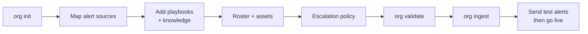

# Integration Guide: Bringing Your Organization

The agents, guardrails, severity engine and approval gate are an **engine**. Everything that differs between organizations lives in an **org pack**: a folder of plain files that a security team owns and edits without touching Python.

| You bring | Goes in | Used by |
|---|---|---|
| Alert sources (SIEM, EDR, SOAR webhooks) | `sources/<name>.json` field mappings | Ingestion webhook, CLI |
| Response playbooks | `playbooks/*.md` | Triage agent and IR agent (RAG); SLA extraction |
| Knowledge: allowlists, known false positives, change calendar | `knowledge/*.md` | Triage agent (RAG) |
| Privileged-account roster | `knowledge/*.csv` or `.md` table | Guardrails (disabled / unlisted accounts) |
| Severity and escalation policy | `org.json` + `ir/*.md` | Severity engine, action planner, IR agent (RAG) |
| Asset criticality, Tier-0 accounts | `org.json` | Severity engine, guardrails |
| Slack / PagerDuty / ticketing endpoints | `org.json` + environment variables | Actuators |

Two packs ship with the repo:

| Pack | Shows |
|---|---|
| `orgs/demo-corp/` | The organization the triage model was fine-tuned on. Reuses the repo's original `rag_docs/` and `ir_docs/` through knowledge globs; alerts in the trained EDR text layout. |
| `orgs/harbor-valley-health/` | A fictional hospital network with *nothing* in common: Sentinel-style and Falcon-style JSON alerts, its own playbooks with `PB-HVH-…` IDs, a CSV roster with `priv-`/`svc-` accounts, clinical asset tiers, stricter auto-close (0.95), different severity cut-offs, HIPAA-driven stakeholders, a regulator notification rule, and Slack + PagerDuty actuators. |

---

## 1. Onboarding in eight steps



```bash
# 1. Scaffold a pack from the template
python -m capstone org init acme                 # creates orgs/acme/

# 2-5. Edit the files (sections 2-6 below)

# 6. Validate: errors must be fixed, warnings are advice
python -m capstone --org acme org validate

# 7. Build the org's two vector indexes
python -m capstone --org acme org ingest

# 8. Try sample alerts end to end, then start the console for this org
python -m capstone --org acme run orgs/acme/samples/generic-json_example.json --source generic-json
SOC_INGEST_KEY=<secret> python -m capstone.web --org acme
```

Set `SOC_ORG=acme` to make it the default for every command. Each org keeps its own state in `runs/<org-id>/` and its own indexes in `orgs/<org-id>/.index/`, so packs never see each other's alerts or incidents.

---

## 2. Alert sources

### 2.1 Mapping file

One file per alerting system, in `sources/<name>.json`. It maps the vendor's JSON onto the engine's canonical fields.

```json
{
  "name": "falcon",
  "description": "EDR detection webhook",
  "type": "json",
  "id_field": "detection_id",
  "fields": {
    "detection":      ["behaviors[0].display_name", "behaviors[0].scenario"],
    "vendor_severity": "max_severity_displayname",
    "timestamp":      ["behaviors[0].timestamp", "created_timestamp"],
    "host":           "device.hostname",
    "device_group":   "device.groups[0]",
    "os":             "device.os_version",
    "user":           "behaviors[0].user_name",
    "process_image":  "behaviors[0].filepath",
    "command_line":   "behaviors[0].cmdline",
    "process_tree":   "behaviors[0].parent_chain",
    "signature":      "behaviors[0].signer",
    "prevalence":     "behaviors[0].prevalence",
    "sha256":         "behaviors[0].sha256",
    "network":        "behaviors[0].network_summary",
    "context":        "behaviors[0].description"
  },
  "constants": {"device_group": "Workstations"}
}
```

| Key | Meaning |
|---|---|
| `type` | `json` for a mapped source; `builtin-edr-text` for the EDR text/JSON layouts the model was trained on |
| `id_field` | Path to the vendor's unique alert ID. Used to ignore webhook retries. Strongly recommended. |
| `fields` | Canonical field → path, or a list of paths (the first non-empty one wins) |
| `constants` | Values for fields the source never sends |

**Paths** use dots for objects and `[n]` for list items: `properties.entities[0].hostName`. A missing path gives an empty value, not an error. Lists of strings are joined (`process_tree` with ` <- `, other fields with `; `), and objects are stored as JSON text.

**Canonical fields:**

| Field | Required | Notes |
|---|---|---|
| `detection` | **yes** | Rule or detection name. Also part of the dedup key. |
| `host` | **yes** | Hostname. Asset rules and dedup key use it. |
| `timestamp` | **yes** | ISO-8601. The UTC day is part of the dedup key. |
| `device_group` | recommended | Drives asset criticality rules |
| `user` | recommended | `DOMAIN\name` or `name@domain`; roster guardrails compare the name part |
| `process_image`, `command_line`, `process_tree`, `context`, `network` | recommended | Scanned for prompt injection; key evidence for the model |
| `vendor_severity`, `os`, `signature`, `prevalence`, `sha256` | optional | Context for the model |

### 2.2 How a vendor alert reaches the model

The triage model was fine-tuned on one alert layout. Mapped alerts are therefore **re-rendered into that layout** before triage, so a Falcon, Sentinel or Splunk alert reaches the model looking like the alerts it learned from:

```
EDR ALERT
Detection: Suspicious access to LSASS process memory
Vendor severity: High
Timestamp: 2026-09-10T19:20:41Z
Host: HV-NS-3E-07 (Device group: Clinical Nurse Stations, OS: Windows 11 23H2)
User: HVH\priv-lchen
Process: C:\Windows\System32\rundll32.exe
Command line: rundll32.exe C:\Windows\System32\comsvcs.dll, MiniDump 688 C:\Windows\Temp\ns.dmp full
Process tree: C:\Windows\System32\cmd.exe <- C:\Windows\System32\WindowsPowerShell\v1.0\powershell.exe
...
```

### 2.3 Sending alerts: the webhook

```
POST /api/ingest/{source}
X-API-Key: <key>
Content-Type: application/json

<one vendor alert object, or a list of up to 50>
```

```bash
curl -X POST http://127.0.0.1:8765/api/ingest/falcon \
  -H "Content-Type: application/json" -H "X-API-Key: $SOC_INGEST_KEY" \
  -d @orgs/harbor-valley-health/samples/falcon_disabled_account_lsass.json
```

Response `202`:
```json
{"accepted": 1, "results": [{"status": "queued", "job_id": "3f9a1c2e", "alert_id": "alt-07e497cf81"}]}
```

| Behavior | Detail |
|---|---|
| Authentication | `X-API-Key` must equal the key in the env var named by `ingest.api_key_env` (default `SOC_INGEST_KEY`). If the variable is unset, a one-time key is generated and printed at startup. Wrong or missing key → `401`. |
| Validation at the door | Unknown source, unparseable payload, or a missing required field → `400` with the reason, before anything is queued |
| Retries | Same source + vendor alert ID → `"status": "duplicate"`, not processed again |
| Ordering | Alerts are queued and triaged one at a time; follow progress at `GET /api/jobs/{job_id}` or in the console |

**Wiring a SIEM:** create a webhook or HTTP action in the SIEM or SOAR that POSTs the alert JSON to the endpoint with the header. Most platforms let you template the payload. If yours does, `generic-json` (flat field names) is the simplest mapping.

### 2.4 Without a webhook

Files work too. A JSON file may hold one alert or a list:
```bash
python -m capstone --org acme run exports/*.json --source generic-json
```

---

## 3. Playbooks and knowledge

### 3.1 Playbook format

```markdown
# PB-ACME-CRED-01 Credential Theft          ← first line: '# <ID> <Title>'

Owner: Incident Response. ...

## Applies to                                ← each '## ' section = one retrieval chunk
Credential dumping (T1003), LSASS access by non-system tools, ...

## Response steps
- Contain the host ...

## SLA                                       ← optional; becomes the incident's SLA
IR lead notified within 30 minutes.
```

| Rule | Why |
|---|---|
| File name starts with `playbook` | The validator applies the playbook checks |
| Title starts with an ID `PB-…-NN` (for example `PB-CRED-01`, `PB-ACME-CRED-01`) | The IR agent cites playbooks by ID; the SLA is read from the playbook it names |
| One topic per `## ` section | Each section is embedded separately, so focused sections retrieve precisely |
| An "Applies to" section naming detections and ATT&CK IDs | That is what retrieval matches alerts against |
| An SLA phrased "within N minutes/hours" | Extracted into the incident. Without one, the severity level's response target is used. |

### 3.2 Knowledge files
Any Markdown in the triage globs: approved tools, known false positives, change calendar, network zones. Tables are chunked **one row per chunk**, which suits rosters and allowlists.

### 3.3 Which files go where
`org.json` → `knowledge` lists globs relative to the pack:
```json
"knowledge": {
  "triage": ["playbooks/*.md", "knowledge/*.md"],
  "ir":     ["playbooks/*.md", "ir/*.md"]
}
```
Globs can point outside the pack (Demo Corp uses `../../rag_docs/*.md`), so a team can keep documents in an existing repository. Re-run `org ingest` after any change.

---

## 4. Identity and assets

### 4.1 Privileged-account roster
```json
"identity": {
  "roster_file": "knowledge/privileged_accounts.csv",
  "account_column": "account",
  "status_column": "status",
  "disabled_marker": "DISABLED",
  "privileged_prefixes": ["priv-", "svc-"],
  "tier0_accounts": ["krbtgt", "domain admins", "ehr-dba-admins"]
}
```
CSV or a Markdown table. Column names are whatever your export uses.

| Guardrail | Fires when | Effect |
|---|---|---|
| `disabled_account` | Alert user's status contains the `disabled_marker` | **Forces escalation** and a minimum of SEV2 |
| `unlisted_admin` | User starts with a privileged prefix but is not in the roster | Blocks auto-close |
| `tier0` | A `tier0_accounts` name appears in the user, command line or context | Blocks auto-close; SEV1 if it becomes an incident |

Keep the roster current: export it from your IAM system on a schedule into the pack.

### 4.2 Asset criticality
```json
"assets": {
  "default": "medium",
  "rules": [
    {"host_prefix": ["HV-DC"], "level": "critical", "tier0": true},
    {"device_group": ["EHR Servers", "PACS Imaging Servers"], "level": "critical"},
    {"device_group_contains": ["clinical", "nurse station"], "level": "high"},
    {"device_group_prefix": ["training"], "level": "low"}
  ]
}
```
The first matching rule wins; all conditions in one rule must match (case-insensitive). Levels are `critical` (3 points), `high` (2), `medium` (1), `low` (0). `tier0: true` marks the asset as Tier-0, which blocks auto-close and forces SEV1.

---

## 5. Severity and escalation policy

### 5.1 Severity cut-offs
```json
"severity": {
  "levels": {"SEV1": 6, "SEV2": 4, "SEV3": 2},
  "response": {"SEV1": "page IR and clinical on-call; CMO within 30 minutes", "SEV2": "...", "SEV3": "...", "SEV4": "..."}
}
```
Score = asset points + impact points (attempted 1 … destructive 4) + scope points (single host 0 … domain-wide 2). An org chooses the score each level needs and the response text. **The overrides are fixed in the engine and cannot be configured away:** Tier-0 or destructive → SEV1, exfiltration → raised one level (minimum SEV2), disabled account → minimum SEV2, plus the impact floors.

### 5.2 Escalation rules
```json
"escalation_policy": [
  {"id": "case", "action": "open_case", "when": {"always": true}, "reason": "Every incident gets a case"},
  {"id": "page-ir", "action": "page_oncall", "target": "IR on-call (security-primary)",
   "when": {"severity_at_most": "SEV2"}, "reason": "SEV1-SEV2 page IR"},
  {"id": "hipaa", "action": "add_stakeholder", "target": "HIPAA Privacy Officer",
   "when": {"signals_any": ["exfiltration"]}, "reason": "Possible PHI disclosure"},
  {"id": "regulator", "action": "notify_external", "target": "State health department liaison",
   "when": {"severity_at_most": "SEV1", "signals_any": ["destructive"]}, "reason": "Regulator notification"}
]
```

| Action | Mode |
|---|---|
| `open_case`, `create_channel`, `post_summary` | automatic (add `"mode": "gated"` to require approval anyway) |
| `page_oncall`, `add_stakeholder`, `notify_external` | **always human-gated**. `"mode": "auto"` on these is a validation error, and the planner gates them regardless. |

| Condition in `when` | Matches when |
|---|---|
| `always: true` | always |
| `severity_at_most: "SEV2"` | SEV1 or SEV2 |
| `severity_at_least: "SEV3"` | SEV3 or SEV4 |
| `signals_any: [...]` | any of `exfiltration`, `destructive`, `credential_theft`, `disabled_account`, `tier0` |
| `host_prefix_any: [...]` | any incident host starts with one of these |
| `techniques_any: [...]` | any ATT&CK ID (parent match: `T1003` matches `T1003.001`) |

All conditions in one `when` must hold. Every matching rule fires.

**Signals** come from ATT&CK IDs and guardrails. The technique lists can be changed per org:
```json
"signals": {"exfiltration": ["T1567", "T1048", "T1041", "T1537", "T1020", "T1052"]}
```

Also describe your policy in plain language in `ir/*.md`. The IR agent reads it through RAG; the engine enforces the JSON.

---

## 6. Outbound systems (actuators)

```json
"actuators": {
  "chat":  {"type": "slack_webhook", "url_env": "HVH_SLACK_WEBHOOK_URL"},
  "pager": {"type": "pagerduty", "routing_key_env": "HVH_PAGERDUTY_ROUTING_KEY"},
  "case":  {"type": "webhook", "url_env": "HVH_CASE_WEBHOOK_URL"}
}
```

| Channel | Actions routed to it |
|---|---|
| `chat` | create_channel, post_summary, add_stakeholder, notify_external |
| `pager` | page_oncall |
| `case` | open_case |

| Type | Sends |
|---|---|
| `mock` (default) | Nothing. Records "would …" in `runs/<org>/actions.jsonl` |
| `slack_webhook` | `{"text": "..."}` to a Slack incoming-webhook URL |
| `pagerduty` | An Events API v2 `trigger` with `dedup_key` = incident ID and severity mapped from SEV |
| `webhook` | The action as JSON (`action_id, incident_id, type, target, channel, payload, reason`) to any URL. Use it for ServiceNow, Jira, Teams or a SOAR flow. |

**Secrets are never stored in the pack**, only the *name* of the environment variable that holds them. If the variable is unset, that channel runs as a mock and the validator warns. A failed delivery is recorded as `FAILED to …` in the action log and shown in the console; it is never silent. Actuators run only for automatic actions or after a human approves.

To add another system, write a class with `send(action)` in `capstone/connectors/actuators.py` and add its type to `build()`.

---

## 7. Validation reference

`python -m capstone --org <id> org validate` exits non-zero on any error, so it can gate a CI pipeline for the pack.

| Area | Errors | Warnings |
|---|---|---|
| disposition / severity | threshold out of range; levels not descending | |
| assets | unknown level or key; rule without a condition | no rules |
| identity | roster file missing; columns not found | no roster (guardrails off) |
| knowledge | no files; missing `# Title`; playbook without a `PB-…` ID | no `##` sections; no SLA; index not built |
| sources | unknown canonical field; required field not mapped; bad type | no `id_field` |
| policy | unknown action/condition/signal/severity; duplicate id; people-reaching action set to auto; missing target | no `open_case`; no `page_oncall` |
| actuators | unknown type; live type without an env-var name | env var not set (runs as mock) |

The console's **Organization** page shows the same results, together with the loaded policy, sources, webhook URLs, asset rules, identity settings, actuators and knowledge files.

---

## 8. Limits to know before going live

- **The triage model was fine-tuned on Demo Corp's environment.** Re-rendering gives it a familiar layout, and RAG gives it the new org's playbooks, but naming conventions it never saw (hosts, tools, accounts) lower its accuracy. Run `capstone.eval_disposition` on a labeled sample of your own alerts before trusting auto-close. Harbor Valley's 0.95 threshold, which no confidence level reaches, is the "never auto-close until measured" setting.
- **One worker, one Ollama.** Throughput is about one alert per 1–3 minutes on a laptop CPU; a GPU or a hosted model is needed for production volume.
- **Console authentication** is out of scope (it binds to localhost); the ingestion webhook has its own key. See [SECURITY.md](SECURITY.md).
